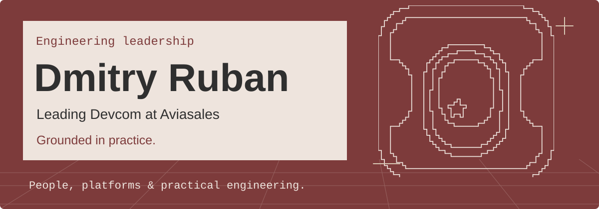

  

### Leading Devcom at Aviasales

I lead engineering across marketing, commercial, and internal products. My work brings together people, technical direction, and delivery — helping teams build on shared practices rather than solve the same problems separately.

I stay hands-on with system design, software development, and automation.

### What I work on

- 🌱 **People & teams** — Hiring, mentoring, and helping engineers grow through meaningful work.
- 🧩 **Architecture & platforms** — Shaping products early and building reusable foundations, integrations, and internal tools.
- ⚙️ **Delivery & automation** — Making priorities, estimates, and releases clearer for engineers and business teams.

I’m also interested in the intersection of technology, media, and audience experience.

---

**[Find me on LinkedIn](https://www.linkedin.com/in/ruban-gt)** — experience, background, and contact.
